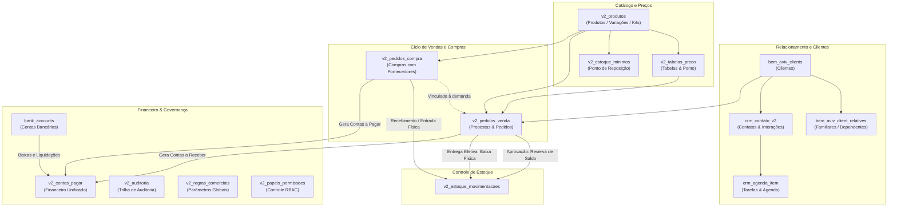

# Documentação Técnica e Funcional — Sistema V2

> **Módulo:** Distribuição, Gestão Comercial, Vendas, Estoque, Financeiro e CRM  
> **Empresa:** Bem Aviv · Saúde e Longevidade (Linha EKO'7)  
> **Versão:** 2.0 (V2)  
> **Data:** Novembro de 2026  

---

## 1. Visão Geral do Projeto (V2)

A **V2** é a evolução da plataforma de gestão comercial da **Bem Aviv**, desenvolvida especificamente para atender a distribuidora e seus representantes comerciais em ambiente web e móvel (PWA).

### 1.1. Objetivos da V2
- **Gestão Comercial Ágil:** Elaboração rápida de propostas, orçamentos comparativos e pedidos de venda em campo ou escritório.
- **Controle Preciso de Estoque:** Separação estrita entre estoque físico, estoque reservado (pedidos aprovados aguardando entrega) e estoque disponível para venda, prevenindo rupturas e vendas duplicadas.
- **Rastreabilidade de Compras:** Vínculo direto entre pedidos de compra e os pedidos de venda que geraram a demanda, incluindo controle de recebimentos parciais e múltiplas notas fiscais (NF-e).
- **Financeiro Integrado:** Conciliação automática de contas a pagar (fornecedores) e contas a receber (clientes), com controle granular de baixas, acréscimos, descontos e taxas de cartão de crédito.
- **CRM Integrado:** Linha do tempo de contatos, histórico de follow-up, produtividade da equipe e integração de agenda.
- **Resiliência e Mobilidade (Offline-First com Nuvem):** Operação contínua mesmo com oscilações de sinal de internet em visitas presenciais, persistindo dados localmente e sincronizando com o Supabase.

### 1.2. Stack Tecnológica
- **Linguagem & Runtime:** TypeScript (modo estrito) + React 18.
- **Build Tool:** Vite + PostCSS.
- **Estilização & UI:** Tailwind CSS, Lucide React (ícones), paleta oficial Bem Aviv (Azul `#0D6BAF`, Verde `#7DC344`, Fundo neutro `#F4F8F3`).
- **Navegação & Roteamento:** `react-router-dom` v6 sob a árvore de rotas `/v2/*`.
- **Backend / Banco de Dados:** Supabase (PostgreSQL 15+, Row Level Security - RLS, PL/pgSQL).
- **PWA & Notificações:** Service Worker com Web Push Notifications (`push_subscriptions` e `push_notification_preferences`).

---

## 2. Diagrama de Arquitetura e Fluxo de Dados

---

## 3. Telas e Módulos da V2

Todas as telas da V2 estão sob o layout compartilhado `V2AppLayout` (`src/v2/components/V2AppLayout.tsx`), que provê:
- Sidebar retrátil para desktop/notebook e tablet (largura de 240px expandida / 72px recolhida).
- Bottom Navigation bar no mobile para os 4 módulos essenciais (Início, CRM, Clientes, Propostas).
- Seletor de empresa/tenant ativo (`CompanyContext`).
- Central de notificações push em tempo real e verificação automática de updates PWA.

---

### 3.1. Autenticação & Usuários

| Rota | Componente | Finalidade & Recursos |
| :--- | :--- | :--- |
| `/v2/login` | `V2SignInPage.tsx` | Tela de autenticação exclusiva da V2. Valida credenciais locais/remotas, persiste token/sessão e direciona o usuário conforme seu papel. |
| `/v2/admin/usuarios` | `V2AdminUsersPage.tsx` | Painel de controle de operadores: cadastro de novos usuários, redefinição de senhas, ativação/desativação e atribuição de perfis de acesso (`administrador`, `vendedor`, `financeiro`, `estoque`). |

---

### 3.2. Início & Visão Geral

| Rota | Componente | Finalidade & Recursos |
| :--- | :--- | :--- |
| `/v2/inicio` | `V2WelcomePage.tsx` | Hub operacional inicial. Apresenta cards de boas-vindas personalizados, atalhos de ação rápida (Nova Proposta, Novo Cliente, Novo Contato, Nova Compra) e contadores de atenção imediata (follow-ups atrasados, produtos abaixo do estoque mínimo, entregas pendentes). |

---

### 3.3. Painel de Vendas (Dashboard Comercial)

| Rota | Componente | Finalidade & Recursos |
| :--- | :--- | :--- |
| `/v2/painel-vendas` | `V2PainelVendasPage.tsx` | Dashboard com inteligência comercial: total vendido no mês, ticket médio, margem de contribuição, ranking dos produtos mais vendidos, comparativo de vendas ano a ano e acompanhamento das metas mensais por vendedor e distribuidor. |

---

### 3.4. CRM Comercial & Relacionamento

| Rota | Componente | Finalidade & Recursos |
| :--- | :--- | :--- |
| `/v2/crm` | `V2CrmPage.tsx` | **Visão Geral do CRM:** Painel consolidado com lista de clientes quentes, próximos contatos agendados e aniversariantes do dia e da semana. |
| `/v2/crm/follow-up` | `V2CrmPage.tsx` | **Central de Follow-up:** Linha do tempo de contatos, filtro por status (pendente, realizado, atrasado), botão de disparo direto para conversa no WhatsApp e modal para registro ágil de novas interações. |
| `/v2/crm/produtividade` | `V2CrmPage.tsx` | **Métricas de Relacionamento:** Contagem de interações por tipo (ligação, WhatsApp, visita presencial, e-mail), taxa de conversão de contatos em visitas e pedidos. |
| `/v2/crm/atividades` | `V2CrmPage.tsx` | **Atividades & Agenda:** Agenda integrada com suporte a tarefas e eventos sincronizáveis com o Google Calendar (`crm_agenda_item`). |

---

### 3.5. Gestão de Clientes

| Rota | Componente | Finalidade & Recursos |
| :--- | :--- | :--- |
| `/v2/clientes` | `V2ClientesPage.tsx` | Gestão completa da carteira de clientes com busca instantânea por nome, CPF/CNPJ, telefone ou cidade. Inclui gaveta lateral (`V2ClientDrawer.tsx`), ficha de follow-up (`V2ClientFollowupSheet.tsx`), cadastro de dependentes/familiares vinculados (`bem_aviv_client_relatives`), histórico de compras do cliente e indicador visual de dias sem contato. |

---

### 3.6. Catálogo de Produtos

| Rota | Componente | Finalidade & Recursos |
| :--- | :--- | :--- |
| `/v2/produtos` | `V2ProdutosPage.tsx` | Cadastro e manutenção do catálogo com suporte a:  • **Produtos Simples:** SKU, descrição, linha, modelo, dimensões (L x C x A), preço de custo (fábrica) e preço de venda sul. • **Produtos com Variação:** Múltiplas dimensões e medidas para a mesma linha. • **Kits Promocionais:** Agrupamento de itens com precificação manual ou cálculo automático. |

---

### 3.7. Tabelas de Preço & Precificação

| Rota | Componente | Finalidade & Recursos |
| :--- | :--- | :--- |
| `/v2/tabela-preco` | `V2TabelaPrecoPage.tsx` | Gerenciamento de tabelas de preço com definição de percentual de reajuste e cálculo do **Valor do Ponto** (5 casas decimais). Implementa a **Regra Especial de Sugestão de Vendas**: calcula o preço com base no reajuste sobre a Tabela Vendas Sul, truncando o valor e ajustando o último dígito (arredondando para final 5 ou para a próxima dezena). |

---

### 3.8. Compras & Fornecedores

| Rota | Componente | Finalidade & Recursos |
| :--- | :--- | :--- |
| `/v2/pedido-compra` | `V2PedidoCompraPage.tsx` | Controle de aquisições com fornecedores: emissão de pedidos de compra, controle de data de emissão retroativa, data prevista de entrega e valor do frete destacado. • **Vínculo com Vendas:** Associação direta aos pedidos de venda atendidos por aquela compra. • **Notas Fiscais:** Registro de múltiplas NFs (número, data, chave de acesso e valor). • **Recebimento Parcial:** Lançamento de entregas parciais com abastecimento automático do estoque físico. |

---

### 3.9. Propostas & Pedidos de Venda

| Rota | Componente | Finalidade & Recursos |
| :--- | :--- | :--- |
| `/v2/propostas-vendas` | `V2PedidoVendasPage.tsx` | Fluxo completo do ciclo de vendas: • **Status:** `proposta` → `aprovado` → `faturado` → `entregue` (ou `cancelado`). • **Canais:** Distribuição própria ou Representação comercial. • **Condições Comerciais:** Preço Normal, Em até 5x (com desconto parametrizado) e À Vista (desconto máximo). • **Comparador:** Modal de comparação lado a lado de orçamentos (`V2OrcamentosComparisonModal.tsx`). • **Comissões:** Cálculo automático da comissão do representante e botão de geração. • **Integração:** Ao aprovar, gera contas a receber no financeiro e reserva saldo no estoque; ao entregar, realiza a baixa física definitiva. |

---

### 3.10. Estoque

| Rota | Componente | Finalidade & Recursos |
| :--- | :--- | :--- |
| `/v2/estoque` | `V2EstoquePage.tsx` | Visão tridimensional do estoque por item: 1. **Físico:** Saldo em depósito. 2. **Reservado:** Comprometido em vendas aprovadas aguardando entrega. 3. **Disponível:** Saldo livre para novas vendas (`Físico - Reservado`). 4. **Mínimo:** Ponto de reposição configurável com alertas visuais. Histórico completo de movimentações (entradas, saídas, reservas, liberações e ajustes manuais por contagem, avaria ou perda). |

---

### 3.11. Financeiro (Contas a Pagar e Receber)

| Rota | Componente | Finalidade & Recursos |
| :--- | :--- | :--- |
| `/v2/contas-pagar` | `V2ContasPagarPage.tsx` | Gestão financeira integrada: • Contas a Pagar (compras e despesas) e Contas a Receber (vendas). • Gaveta de Novo Lançamento (`V2NovoLancamentoDrawer.tsx`). • Gaveta de Baixa Inteligente (`V2BaixaDrawer.tsx`) com cálculo de juros/multas, descontos e destinação para a conta bancária correta. • Módulo de Comissões (`V2GerarComissoesModal.tsx` e `V2RelatorioComissoes.tsx`). • Extrato consolidado por instituição bancária (`extrato.ts`). |

---

### 3.12. Relatórios & Analytics

| Rota | Componente | Finalidade & Recursos |
| :--- | :--- | :--- |
| `/v2/relatorios` | `V2RelatoriosPage.tsx` | Emissão de relatórios analíticos: vendas por período, curva ABC de clientes e produtos, faturamento líquido e resumo de comissões pagas e pendentes. |

---

### 3.13. Tags

| Rota | Componente | Finalidade & Recursos |
| :--- | :--- | :--- |
| `/v2/tags` | `V2TagsPage.tsx` | Gerenciador central de etiquetas para categorização dinâmica de clientes, pedidos e produtos. |

---

### 3.14. Configurações Globais

| Rota | Componente | Finalidade & Recursos |
| :--- | :--- | :--- |
| `/v2/configuracoes` | `V2SettingsPage.tsx` | Central de parametrizações com sub-abas: • **Fornecedores:** Gestão de parceiros comerciais e dados cadastrais. • **Representantes:** Cadastro de representantes/distribuidores e metas mensais. • **Formas de Pagamento:** Parametrização de taxas de parcelamento e prazos de repasse. • **Regras Comerciais (`V2SettingsRegrasComerciais.tsx`):** Margem mínima, validade de orçamentos, reserva automática de estoque. • **Papéis & Permissões (`V2SettingsPapeis.tsx`):** Matriz RBAC para perfis de acesso. • **Auditoria (`V2SettingsAuditoria.tsx`):** Trilha imutável de logs e auditoria. • **Notificações Push (`V2SettingsNotificacoes.tsx`):** Alertas PWA no dispositivo. |

---

## 4. Dicionário de Tabelas de Persistência (Supabase / PostgreSQL)

### 4.1. Tabelas Nativas da V2

#### 1. `v2_users`
Armazena os usuários autorizados a operar a V2 e seus respectivos perfis de acesso.
- `id` (text, PK): Identificador do usuário.
- `full_name` (text): Nome completo do operador.
- `username` (text, unique): Login de acesso.
- `email` (text, nullable): E-mail para contato e recuperação.
- `password_hash` (text): Hash da senha de acesso.
- `role` (text): Papel no sistema (`administrador`, `vendedor`, `financeiro`, `estoque`).
- `created_at` (timestamptz): Data de cadastro.

#### 2. `v2_produtos`
Catálogo central de produtos da V2, suportando itens simples, variações e kits.
- `id` (text, PK): Identificador único do produto.
- `code_sku` (text): Código SKU do produto.
- `name` (text): Descrição comercial do produto.
- `type` (text): Tipo do item (`SIMPLES`, `VARIACAO`, `KIT`).
- `category` (text): Categoria do item (Colchões, Cabeceiras, Acessórios, etc.).
- `product_line` (text): Linha comercial do produto.
- `model` (text): Modelo do produto.
- `unit` (text): Unidade de medida (UN, CJ, etc.).
- `cost_price` (numeric): Preço de custo da fábrica (R$).
- `sale_price` (numeric): Preço base da Tabela Vendas Sul (R$).
- `dim_width_cm`, `dim_length_cm`, `dim_height_cm` (numeric): Dimensões físicas (L x C x A).
- `variations` (jsonb): Array de variações com SKUs, preços e medidas específicas.
- `kit_items` (jsonb): Array de produtos componentes do kit com quantidades e preços unitários.
- `kit_price_mode` (text): Modo de precificação do kit (`AUTO` ou `MANUAL`).
- `active` (boolean): Indicador de produto ativo/inativo.
- `created_at` (timestamptz): Data de criação.

#### 3. `v2_tabelas_preco`
Configurações de tabelas de preços com índices de reajuste e cálculo de pontos.
- `id` (text, PK): Identificador da tabela de preço.
- `name` (text): Nome descritivo da tabela (ex.: Tabela Padrão Distribuidor).
- `reajuste_percent` (numeric): Percentual de reajuste aplicado sobre o preço base.
- `valor_ponto` (numeric): Valor base para cálculo da pontuação do produto.
- `items` (jsonb): Lista de itens precificados contendo Tabela Fábrica, Tabela Vendas Sul, Sugestão de Vendas e Ponto calculado.
- `active` (boolean): Se a tabela está disponível para novas vendas.
- `is_default` (boolean): Define se é a tabela padrão pré-selecionada.
- `created_at`, `updated_at` (timestamptz): Carimbos de data/hora.

#### 4. `v2_pedidos_compra`
Aquisições de produtos realizadas com fábricas e fornecedores.
- `id` (text, PK): Identificador único do pedido de compra.
- `numero` (text/numeric): Número sequencial de identificação.
- `fornecedor` (text): Razão social ou nome fantasia do fornecedor.
- `status` (text): Situação (`rascunho`, `emitido`, `recebido_parcial`, `recebido`, `cancelado`).
- `dataEmissao`, `dataPrevistaEntrega` (text): Datas acordadas de emissão e previsão.
- `dataPedido`, `dataVencimento`, `dataRecebimentoPrevista` (text): Prazos financeiros e logísticos.
- `frete` (numeric): Valor do frete destacado da compra.
- `total` (numeric): Valor total da compra somado ao frete.
- `numeroParcelas` (integer): Quantidade de parcelas a pagar.
- `formaPagamento` (text): Forma de quitação com a fábrica.
- `itens` (jsonb): Lista de produtos, quantidades compradas e já recebidas.
- `recebimentos` (jsonb): Histórico de entregas parciais com datas e quantidades.
- `notasFiscais` (jsonb): Notas fiscais vinculadas (número, data, chave e valor).
- `pedidosVendaVinculados` (jsonb): Pedidos de venda atendidos por este pedido de compra.
- `created_at`, `updated_at` (timestamptz): Metadados de auditoria.

#### 5. `v2_pedidos_venda`
Propostas comerciais e pedidos de venda efetuados pela distribuição.
- `id` (text, PK): Identificador único da proposta/venda.
- `numero` (text): Código sequencial (ex.: `PV-20261011001`).
- `canal` (text): Canal de comercialização (`distribuicao` ou `representacao`).
- `status` (text): Ciclo da venda (`proposta`, `aprovado`, `faturado`, `entregue`, `cancelado`).
- `cliente_id`, `cliente_nome`, `cliente_documento`, `cliente_cidade` (text): Dados do cliente comprador.
- `tabela_preco_id`, `tabela_preco_nome` (text): Tabela de preço aplicada.
- `dataEmissao`, `dataPrevistaEntrega`, `dataEntrega`, `dataVencimento` (text): Marcos temporais.
- `formaPagamento` (text): Condição de pagamento pactuada.
- `frete` (numeric): Custo de frete cobrado do cliente.
- `subtotal`, `descontoTotal`, `total` (numeric): Composição financeira do pedido.
- `desconto5xPercentual`, `total5x` (numeric): Condição parametrizada em 5 parcelas.
- `descontoVistaPercentual`, `totalVista` (numeric): Condição parametrizada à vista.
- `condicaoSelecionada` (text): Opção comercial escolhida (`sem_desconto`, `ate_5x`, `a_vista`).
- `vendedor_nome`, `comissao_percentual`, `comissao_valor`, `comissao_valor_total` (numeric/text): Gestão de comissões.
- `comissao_gerada` (boolean): Se o lançamento financeiro da comissão já foi criado.
- `itens` (jsonb): Relação de itens vendidos, preços de tabela, descontos e totais.
- `created_at`, `updated_at` (timestamptz): Carimbos temporais.

#### 6. `v2_estoque_movimentacoes`
Livro-razão com o histórico de todas as alterações quantitativas do estoque.
- `id` (text, PK): Identificador do registro de movimentação.
- `produto_id`, `produto_nome` (text): Identificação do item movimentado.
- `tipo` (text): Natureza do movimento (`entrada`, `saida`, `reserva`, `liberacao`, `ajuste`).
- `quantidade` (numeric): Quantidade movimentada (positiva para entradas/liberações, negativa para saídas/reservas).
- `origem` (text): Origem do evento (ex.: Pedido de Venda #PV-001, Pedido de Compra #PC-002).
- `referencia` (text): Código do documento gerador.
- `data` (text): Data de registro.
- `usuario_nome` (text): Operador responsável pelo lançamento.
- `motivo` (text): Justificativa para ajustes manuais (`Contagem`, `Perda`, `Avaria`, `Devolução`).
- `observacao` (text): Detalhes complementares.
- `custo_unitario` (numeric): Custo contábil do item no momento do movimento.
- `created_at` (timestamptz): Carimbo de inserção no banco.

#### 7. `v2_estoque_minimos`
Parametrização dos estoques de segurança por produto.
- `produto_id` (text, PK): Referência ao produto.
- `estoque_minimo` (numeric): Ponto de reposição mínimo tolerado.
- `updated_at` (timestamptz): Data da última alteração do parâmetro.

#### 8. `v2_contas_pagar`
Módulo financeiro unificado para despesas, contas a pagar e contas a receber.
- `id` (text, PK): Identificador único do título financeiro.
- `tipo` (text): Natureza do lançamento (`pagar` ou `receber`).
- `pedido_id` (text, nullable): Vínculo com pedido de compra ou pedido de venda.
- `descricao` (text): Descrição ou histórico do lançamento.
- `fornecedor` (text): Fornecedor ou cliente contraparte.
- `origem` (text): Canal de origem (`compra`, `venda`, `avulsa`, `recorrente`).
- `categoria` (text): Plano de contas ou centro de custo.
- `total` (numeric): Valor nominal previsto.
- `totalPago` (numeric): Valor efetivamente liquidado até o momento.
- `status` (text): Estado do título (`aberta`, `parcial`, `paga`, `vencida`, `cancelada`).
- `vencimento` (text): Data de vencimento principal.
- `forma_pagamento` (text): Método de pagamento.
- `taxa_administradora` (numeric): Dedução de taxa de cartão/intermediação.
- `conta_bancaria_id` (text): Conta bancária de débito/crédito vinculada.
- `parcelas` (jsonb): Lista de parcelas contendo número, vencimento, valor, status e registro de baixa (`BaixaParcelaInfo`: data da baixa, descontos, acréscimos, valor final pago e conta bancária de liquidação).
- `created_at`, `updated_at` (timestamptz): Metadados de auditoria.

#### 9. `v2_regras_comerciais`
Configuração de parâmetros comerciais globais da empresa.
- `id` (text, PK): Chave única fixa (`global_config`).
- `margem_minima` (numeric): Percentual mínimo de margem de lucro exigido.
- `validade_proposta_dias` (integer): Dias de validade dos orçamentos emitidos.
- `forma_pagamento_padrao` (text): Forma de pagamento pré-selecionada.
- `reservar_estoque_aprovacao` (boolean): Se a aprovação da proposta reserva estoque de imediato.
- `exigir_assinatura_cliente` (boolean): Se requer aceite/assinatura antes de faturar.
- `permitir_estoque_insuficiente` (boolean): Se permite gerar pedidos mesmo sem saldo livre.
- `gerar_contas_receber_ao_aprovar` (boolean): Se gera o contas a receber automaticamente na aprovação.
- `adiantamento_ja_baixado` (boolean): Se marca entrada/adiantamento como pago de imediato.
- `updated_at` (timestamptz): Data da última alteração de parâmetros.

#### 10. `v2_papeis_permissoes`
Matriz de controle de acessos RBAC (Role-Based Access Control).
- `id` (text, PK): Código do papel (`administrador`, `vendedor`, `financeiro`, `estoque`).
- `nome` (text): Nome descritivo do papel.
- `descricao` (text): Resumo das atribuições.
- `modulos` (jsonb): Permissões por módulo (`ver`, `criar_editar`, `excluir_cancelar`).
- `permissoes_especiais` (jsonb): Permissões avançadas (`ver_custo_margem`, `desconto_maximo`, `aprovar_margem_baixa`, `ajustar_estoque`, `estornar_excluir_financeiro`, `ver_auditoria`).
- `updated_at` (timestamptz): Carimbo de atualização.

#### 11. `v2_auditoria`
Trilha de auditoria das operações críticas executadas na plataforma.
- `id` (text, PK): Identificador do log (ex.: `#A-000418`).
- `data_hora` (timestamptz): Momento exato da ocorrência.
- `usuario_nome` (text): Nome do operador que realizou a ação.
- `area` (text): Módulo afetado (`Venda`, `Desconto`, `Estoque`, `Financeiro`, `Permissão`, `Sistema`).
- `objeto` (text): Identificador do registro modificado.
- `o_que_mudou` (text): Resumo textual da alteração.
- `detalhe` (jsonb): Objeto com a lista de campos modificados (`campo`, `antes`, `depois`).
- `created_at` (timestamptz): Data de gravação do log.

#### 12. `crm_contato_v2`
Registros das interações e atendimentos realizados com clientes.
- `id` (uuid, PK): Identificador único do contato.
- `company_id` (uuid): Empresa ativa.
- `cliente_id` (uuid, FK `bem_aviv_clients`): Cliente contatado.
- `tipo` (crm_tipo_contato): Modalidade (`ligacao`, `whatsapp`, `email`, `visita`, `reuniao`, `outro`).
- `direcao` (crm_direcao): Fluxo (`recebido` ou `realizado`).
- `assunto`, `descricao`, `resultado` (text): Detalhes da interação.
- `ocorrido_em` (timestamptz): Data e hora em que a interação ocorreu.
- `responsavel_id` (text): Operador que realizou o contato.
- `proximo_contato_em` (timestamptz): Agendamento da próxima interação de retorno.
- `criado_em`, `atualizado_em`, `cancelado_em` (timestamptz): Ciclo de vida do registro.

#### 13. `crm_agenda_item`
Tarefas, compromissos e visitas integráveis à agenda do Google.
- `id` (uuid, PK): Identificador único do item de agenda.
- `company_id` (uuid): Empresa associada.
- `tipo` (crm_tipo_agenda): Classificação (`evento` ou `tarefa`).
- `titulo`, `descricao` (text): Conteúdo do compromisso.
- `inicio`, `fim` (timestamptz): Horários de início e término.
- `dia_inteiro` (boolean): Flag de evento que dura o dia todo.
- `cliente_id` (uuid, FK): Cliente relacionado.
- `contato_id` (uuid, FK `crm_contato_v2`): Interação que originou a tarefa.
- `origem` (crm_origem): Fonte do agendamento (`sistema` ou `google`).
- `google_id`, `google_etag` (text): Identificadores de sincronismo com o Google Calendar.
- `sync_status` (crm_sync_status): Situação do sincronismo (`pendente`, `sincronizado`, `erro`).
- `concluido_em`, `cancelado_em` (timestamptz): Estado de conclusão da atividade.

#### 14. `crm_google_sync_state` & `crm_google_token`
Estado e credenciais seguras para sincronização com o Google Workspace (Calendar e Tasks).
- Guarda conta sincronizada, tokens de paginação (`events_sync_token`), canais de webhook e tokens OAuth2.

---

### 4.2. Tabelas Compartilhadas Reutilizadas pela V2

#### 1. `bem_aviv_clients`
Base única de clientes da Bem Aviv.
- Contém `id`, `company_id`, `full_name`, `cpf`, `birth_date`, `phone_1`, `phone_2`, `email`, dados completos de endereço (`cep`, `address_street`, `address_number`, `address_complement`, `address_district`, `address_city`, `address_state`), `commercial_stage`, `client_status` (derivado automaticamente por trigger), `eko7_presentation_at` e `group_reference`.

#### 2. `bem_aviv_client_relatives`
Parentes, dependentes e indicações vinculados ao cliente principal.
- Campos: `id`, `client_id`, `name`, `relationship`, `cpf`, `phone`, `birth_date`, `notes`.

#### 3. `bem_aviv_client_followups`
Histórico de follow-ups e contatos comerciais sincronizados.
- Contém `id`, `client_id`, `contact_type`, `contact_date`, `notes`, `next_contact_date`, `user_id`, `status`.

#### 4. `bem_aviv_suppliers` (ou `suppliers`)
Cadastro de fornecedores homologados.
- Contém razão social (`legal_name`), nome fantasia (`trade_name`), CNPJ, inscrição estadual, contatos, categoria e observações.

#### 5. `bem_aviv_representatives`
Cadastro de representantes comerciais e distribuidores.
- Contém código (`REP-001`), nome, papel (`DISTRIBUIDOR` ou `REPRESENTANTE`), CPF/CNPJ, taxa de comissão padrão (`commission_rate`) e status.

#### 6. `bem_aviv_representative_goals`
Metas de vendas mensais por representante.
- Contém `representative_id`, `month` (mês de referência), `sales_goal` (meta financeira em R$) e `visits_goal` (meta de visitas a clientes).

#### 7. `bem_aviv_payment_methods` & `bem_aviv_payment_method_rates`
Meios de pagamento aceitos e grade de taxas de cartão.
- Define a forma de pagamento (PIX, Boleto, Cartão de Crédito), prazo de repasse em dias e percentual de taxa cobrado pela operadora para cada parcela de 1x a 18x.

#### 8. `bank_accounts`
Contas correntes e carteiras digitais cadastradas no sistema (ex.: Mercado Pago, Banco Inter) utilizadas para lançar os recebimentos de vendas e pagamentos de compras.

#### 9. `push_notification_preferences` & `push_subscriptions`
Armazenamento das configurações de alertas Web Push do PWA para dispositivos móveis, incluindo avisos de aniversariantes, follow-ups atrasados e feedback de entrega.

---

## 5. Estratégia de Persistência e Sincronização

A V2 foi arquitetada para atender à realidade de equipes em trânsito e em visitas de campo:
1. **Camada Online (Supabase):** Qualquer operação realizada consulta e grava diretamente no PostgreSQL com Row Level Security (RLS) ativo.
2. **Camada de Cache Local (`localStorage`):** Serviços realizam leitura imediata no cache para renderização instantânea (zero layout shift) e gravam no cache antes de despachar a chamada à API.
3. **Tratamento de Exclusões (Tombstones):** Para evitar que um registro apagado localmente reapareça ao sincronizar com a nuvem, chaves específicas de controle (ex.: `v2_contas_pagar_deleted_ids`) registram os IDs removidos até que a exclusão seja confirmada no banco.
4. **Consistência em Transações:** Operações de alteração de estoque e faturamento financeiro são vinculadas ao ciclo de vida do pedido de venda, impedindo geração de saldos inconsistentes.
